<div align="center">


</div>

<br />

<div align="center">

### AI Agents, by the numbers


<sub>Jul~Sep 2026 · Claude Code + Codex · tokens processed, counted from local session logs</sub>

<br /><br />



</div>

<br />

<table align="center">
<tr>
<td width="50%" valign="top">

#### 🔁 How I work with agents

```
me ─ planning ─→ plans (1 plan = 1 PR)
                   │
            orch (coordinator)
   ┌───────────────┼───────────────┐
 worker          worker          worker
 (worktree)      (worktree)      (worktree)
 critic → build → review → PR
   └───────────────┼───────────────┘
          verify → merge → cleanup
```

**설계는 직접 합의하고, 실행은 여러 에이전트에 나눠 맡깁니다.**
작업을 PR 단위 계획으로 쪼개 Orca 로 worker 를 워크트리마다 띄우고,
worker 가 계획 검토부터 리뷰까지 거쳐 낸 PR 을 코디네이터가 검증해 머지합니다.

</td>
<td width="50%" valign="top">

#### ✅ How I know it works

`반복 평가` 같은 입력을 3번 돌려 3번 모두 통과해야 합격
`다른 심사자` 실행한 모델이 아닌 모델이 버전 붙인 기준표로 채점
`추적` 모델·도구 호출을 한 기록으로 묶어 실패 지점을 찾음
`운영 측정` 로컬에서 30% 빨랐던 변경이 운영 GPU에선 1%여서, 성능은 운영에서 잰다

**에이전트가 낸 결과도, 에이전트가 짠 코드도**
**같은 기준으로 확인합니다.**

</td>
</tr>
</table>

<br />

<div align="center">

### Stack


</div>

<br />

<div align="center">

### Built with this workflow

| | |
|:--|:--|
| **[dooray-cli](https://github.com/jon890/dooray-cli)** | 사내 업무 도구를 에이전트가 다루도록 감싼 CLI |
| **[fos-assistant](https://github.com/jon890/fos-assistant)** | Hermes Agent 위에 올린 self-hosted Control Plane. 다중 사용자 대화, 에이전트별 Memory 권한, 사용량 집계 |
| **[nhncloud-cli](https://github.com/jon890/nhncloud-cli)** | 인스턴스, 클러스터 업그레이드, 로그 조회 자동화 |

</div>

<br />

<div align="center">


</div>

<div align="center">


</div>
